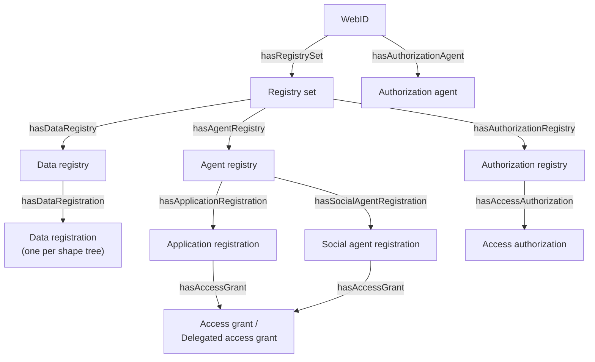

## Solid Application Interoperability

**Updated in:** `activitypods@2.3`

[Solid Application Interoperability](https://solid.github.io/data-interoperability-panel/specification) (SAI) helps applications to be interoperable, while only giving them access to the resources they need. We use it both for application registrations and for sharing data between users.

SAI introduces many new concepts, such as Shape Trees, Authorization Agents, Data Registrations, Access Grants, etc. We recommend to have a look at the [Application Primer](https://solid.github.io/data-interoperability-panel/primer/application.html) to understand them. The [key concepts](/key-concepts/) page gives a simpler overview.

### Registries

The WebID of each user links to its authorization agent (`interop:hasAuthorizationAgent`) and to its registry set (`interop:hasRegistrySet`). The registry set links to three registries:



- The **data registry** lists the data registrations. Each of them is a LDP container holding the resources of a given shape tree (`interop:registeredShapeTree`). They are created when an application needs a shape tree for the first time.
- The **agent registry** lists the applications installed by the user, as well as the other users (social agents) with whom they shared data.
- The **authorization registry** lists the access authorizations given by the user. Each of them generates an access grant, which is attached to the registration of the grantee.

### Authorizations and grants

When a user installs an application, an access authorization is created for each accepted access need. Its scope is defined by the `interop:preferredScope` of the access need (`interop:All` by default, which means all the resources of the shape tree, including those shared with the user).

When a user shares a resource, an access authorization with the `interop:SelectedFromRegistry` scope is created for each recipient, with the shared resource in `interop:hasDataInstance`.

:::note
Unlike the specification, we don't use Data Authorizations and Data Grants: an access authorization (and the access grant it generates) is linked to a single shape tree and a single data registration. This makes them much simpler to handle.
:::

### Delegated access grants

When Alice shares a resource with Bob, Bob's applications need permission to read it. Bob's authorization agent requests Alice's delegation endpoint (`interop:hasDelegationIssuanceEndpoint`), which checks that Bob has a grant for this resource and issues a delegated access grant (`interop:DelegatedAccessGrant`) for each of Bob's applications handling this shape tree. These delegated grants are attached to the application registrations in Bob's Pod, and they point to the original grant with `interop:delegationOfGrant`.

If Alice allowed Bob to share the resource (`interop:delegationAllowed`), Bob can in turn give access to other users, up to the `interop:delegationLimit`.

See [Contacts and sharing](/app-framework/contacts-and-sharing/) for how to share resources from an application.

### Authorization agent endpoints

The authorization agent of a Pod provider exposes the following endpoints:

| Endpoint                                 | Description                                                                                                     |
| ---------------------------------------- | --------------------------------------------------------------------------------------------------------------- |
| `/.auth-agent/app-registrations`         | Registers, upgrades or removes an application. A `GET` returns the registration of an agent.                    |
| `/.auth-agent/authorizations?resource=…` | Lists or updates the authorizations given for a single resource (used to share it).                             |
| `/.auth-agent/delegation/issue`          | Used by other authorization agents to obtain delegated access grants (`interop:hasDelegationIssuanceEndpoint`). |

Users are redirected to the Pod provider frontend (`interop:hasAuthorizationRedirectEndpoint`) to accept the access needs of an application, or to share a resource.

## Type Indexes

[TypeIndexes](https://github.com/solid/type-indexes) are Solid's recommended method to discover in what LDP containers the resources are being stored. In ActivityPods, we have implemented a public TypeIndexes, that are linked to the WebID with the `solid:publicTypeIndex` predicate, as well as private TypeIndexes that are linked with the user's Preference File.

Applications should rather use the data registrations described above, but the TypeIndexes are kept up to date for applications that don't support SAI.

Since we don't support RDF documents, we use a custom `solid:hasTypeRegistration` predicate to link the `solid:TypeIndex` with the various `solid:TypeRegistration`, and we dereference them for easier handling. See [this issue](https://github.com/solid/type-indexes/issues/29) for more details.

```
{
   "id":"https://mypod.store/sro/data/9abafd71-39d9-47f2-8a1d-a50cb6a0a5c6",
   "type":[ "solid:TypeIndex", "solid:ListedDocument"],
   "solid:hasTypeRegistration":[
      {
         "id":"https://mypod.store/sro/data/da9c1935-1c9d-4660-81de-183657c2a7a7",
         "type":"solid:TypeRegistration",
         "solid:forClass":"vcard:Group",
         "solid:instanceContainer":"https://mypod.store/sro/data/vcard/group"
      },
      ...
   ]
}
```
