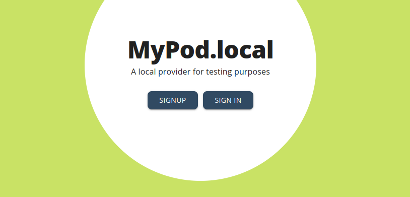
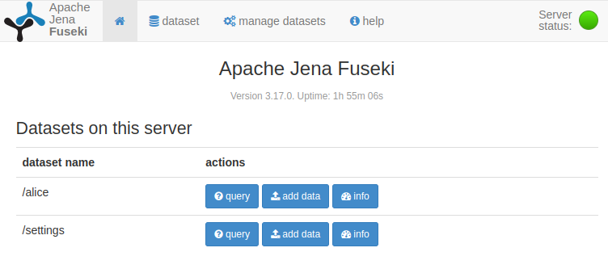

We created a boilerplate to help you quickly setup a social app in a local environment, and connect it with a local Pod provider. In just a few minutes, you should be able to play with your first ActivityPods-compatible app!

## Requirements

- Git
- Makefile
- [Docker](https://docs.docker.com/engine/install/) (make sure you have the `docker-compose-plugin` installed)
- [NodeJS](https://nodejs.org) 22.12 or above
- [Yarn](https://yarnpkg.com/)

4Gb of RAM is required for Jena Fuseki to work properly.

## Clone the boilerplate repository

First clone and initialize the [boilerplate repository](https://github.com/activitypods/app-boilerplate):

```bash
git clone https://github.com/activitypods/app-boilerplate.git # <optionally your app name>
cd app-boilerplate # <or your app name>

# Initialize new git repository
rm -rf .git
git init
```

## Run the Pod provider

In order to locally run the boilerplate, you need a local Pod provider, because a remote Pod provider will not be able to interact with a local application backend.

Fortunately, we provide [Docker images](https://hub.docker.com/orgs/activitypods/repositories) to launch a local Pod provider in a single command:

```bash
make start
```

This will also launch Jena Fuseki (the triplestore used to store semantic data) and Redis, which are needed by the Pod provider and will also be used by the application.

:::warning
If you are on Windows, please note that you might have to enable host networking on your docker engine to get the pod provider backend expose its port.
:::

:::note
An alternative to creating a local Pod provider is to use a tunnel for your boilerplate app like [Ngrok](https://ngrok.com/), [zrok](https://zrok.io/) or [loophole](https://loophole.cloud/docs/guides/expose) so that your application backend is accessible from the web. Feel free to improve this guide if you chose this solution!
:::

## Create an account

If everything is running fine, you should be able to access your newly-created Pod provider at http://localhost:5000



The configuration of the Pod provider should be visible at http://localhost:3000/.well-known/config.js (this javascript file is loaded by its frontend at the very beginning).

You can go ahead and create an account.

The Fuseki interface is accessible at http://localhost:3030. In local environment, the login and password are "admin". After having created your first account, a dataset should be created with the same name. There should be a `settings` dataset as well, which list all available accounts.



:::note
If there is a problem, in particular if the second link is not working, you can access the Pod provider backend with this command `make attach-activitypods`. This will give you access to ActivityPods' Moleculer CLI. [Moleculer](https://moleculer.services/) is the microservice framework that all ActivityPods services run on. If there are errors, they will be displayed here.
:::

## Launch the app backend

Although Docker could also be used to launch the application backend, we recommend to launch it outside of Docker to avoid the usual problems we encounter in containerized environments.
The boilerplate application backend uses the [Moleculer](https://moleculer.services/) microservice framework for node.js as well.

On the other hand, we will use the same Fuseki and Redis server as used for the ActivityPods backend.

```bash
cd backend
yarn install
yarn run dev
```

This will bootstrap the server and, if there are no errors, finish with a message telling you that the Moleculer ServiceBroker has started.

You can see the application details at http://localhost:3001/app

## Launch the app frontend

Now you can launch the app frontend.

```bash
cd frontend
yarn install
yarn run dev
```

You can now access the app frontend at http://localhost:4001

## Log in to the app

The login page only offers your local Pod provider, because it is set as the `VITE_POD_PROVIDER_BASE_URL` variable in the `frontend/.env` file. Public Pod providers would not be able to reach your local application backend.

Choose your local Pod provider: it will ask you to authorize the app to access your data, then redirect you to the app. You can now create an event. It will be stored in your Pod, and the app backend will add a summary to it (see `backend/services/events.service.js`).

## Play with the boilerplate

The "Hot module reload" feature is activated on both the frontend and the backend, so you can do changes to the code and it will be visible almost immediately.

The frontend is built with [Refine](https://refine.dev/core/docs/) and [Ant Design](https://ant.design). Check their documentation to find what you can do, as well as the documentation of the [ActivityPods frontend packages](../../app-framework/frontend/introduction/). Here's where to start in the `frontend/src` directory:

| File or directory     | Content                                                                                                                                                                                                                                      |
| --------------------- | -------------------------------------------------------------------------------------------------------------------------------------------------------------------------------------------------------------------------------------------- |
| `config/providers.ts` | The [auth provider](../../app-framework/frontend/auth-provider/), the [data provider](../../app-framework/frontend/data-provider/) and the live provider of `@activitypods/refine-providers`, and the shape tree of each resource of the app |
| `App.tsx`             | The Refine resources and their routes, and the `LoginPage` of `@activitypods/refine-antd`                                                                                                                                                    |
| `Layout.tsx`          | The layout of the app, wrapped in the `BackgroundChecks` component of `@activitypods/refine-antd`                                                                                                                                            |
| `resources/`          | The pages of each resource. `events/JoinButton.tsx` shows how to use the [`useOutbox` and `useCollection` hooks](../../app-framework/frontend/inbox-and-outbox/) of `@activitypods/refine-hooks`                                             |

To handle other types of data, see the [next guide](../add-new-types-of-data-to-your-app/).

For the backend, you will find plenty of documentation on this website.

You can test emails are correctly sent by opening up the Mailcatcher interface at http://localhost:1080. You can also watch the jobs queue at http://localhost:4567

Enjoy! And if you run into any problem, please don't hesitate to open an [issue](https://github.com/activitypods/activitypods/issues)!
