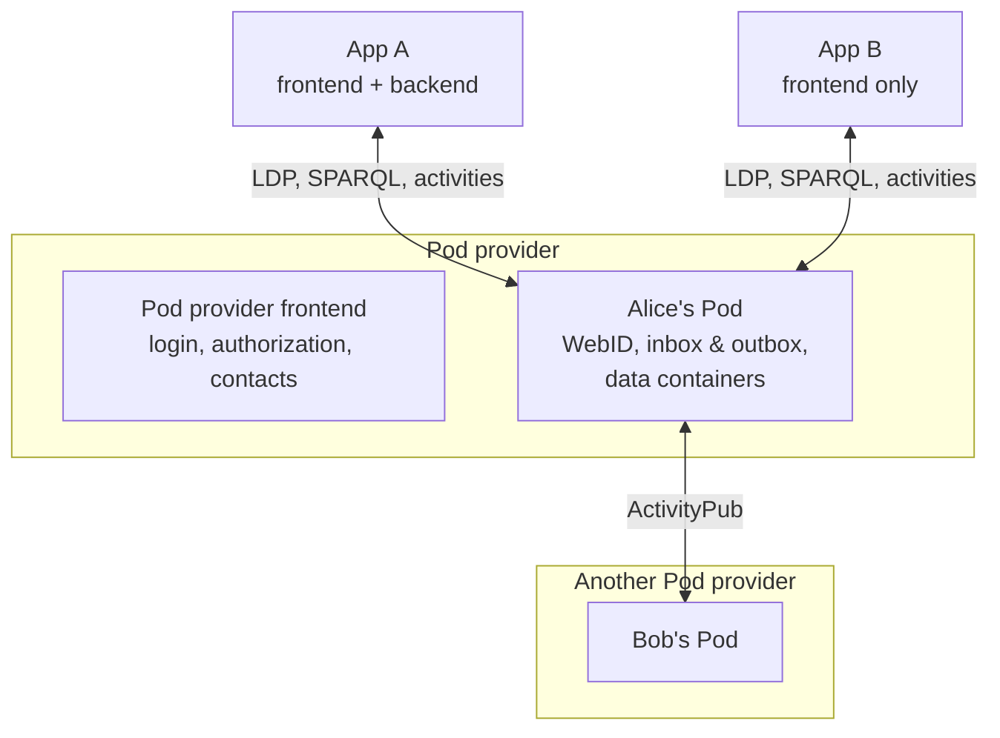
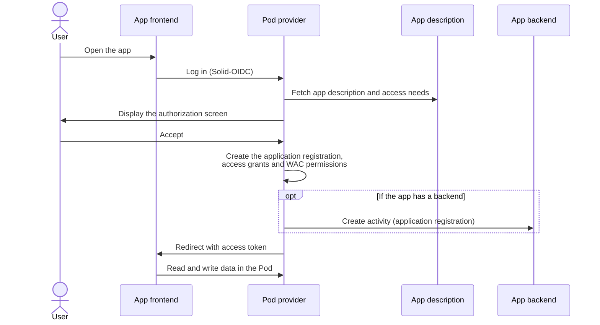

ActivityPods combines two W3C-backed ecosystems: [Solid](https://solidproject.org), where users keep their data in a personal online storage, and [ActivityPub](https://www.w3.org/TR/activitypub/), the protocol of the Fediverse. Applications don't have their own database: they read and write the data in the users' Pods, and they communicate with each other through ActivityPub activities.

This page introduces the main concepts. The [architecture section](/architecture/application-interoperability/) describes the standards in more details.

## Pod

A Pod is the personal storage of a user. It contains:

- A **WebID**, which identifies the user. It is also an ActivityPub actor, with an inbox, an outbox, followers, etc. (see [Identity](/architecture/identity/)).
- **Data containers**, where resources are stored as linked data (JSON-LD), following the [Linked Data Platform](/architecture/resources-management/) protocol. Binary files can be stored too.
- **Collections**, such as the user's contacts or the list of resources shared with them.
- **Registries**, which keep track of the applications the user has installed and of the rights given to them.

Every user has a dedicated dataset in the triplestore, and the data can be queried with SPARQL.

## Pod provider

A Pod provider is a server hosting Pods for many users. Anyone can [deploy their own](/guides/deploy-your-own-pod-provider/).

It comes with a frontend where users can create an account, log in, see their data, manage their contacts and choose which applications can access their Pod. This frontend plays the role of the **authorization agent** described by the [Solid Application Interoperability](/architecture/application-interoperability/) (SAI) specification.

The Pod provider is also the OIDC provider of its users: they log in to applications with their Pod account ([Solid-OIDC](/architecture/authentication/)).

## Application

An application is made of a frontend and, optionally, a backend.

- The **frontend** is where users interact with their data. It talks directly to their Pod, with the access token obtained at login. See the [frontend introduction](/app-framework/frontend/introduction/).
- The **backend** is an ActivityPub actor of type `Application`, with its own WebID. It is needed to react to activities, to send notifications or to read and write data when the user is not connected. See the [backend introduction](/app-framework/backend/introduction/).

Every application is described by a public JSON-LD document: its name, its OIDC settings and its access needs. When there is a backend, this document is the backend's actor. Otherwise, it can be a static file served with the frontend.

Since the data is not stored in the application, users can change applications without losing anything, and several applications can work on the same data.

## Shapes and shape trees

To be interoperable, applications must agree on the kind of data they handle. They declare it with **shape trees**, published at a public URL, which point to **shapes** ([SHACL](https://www.w3.org/TR/shacl/)) describing the expected data. A repository of shared shape trees is available on [shapes.activitypods.org](https://shapes.activitypods.org).

When an application asks for a shape tree that no other application has used before, a container is created in the Pod for this type of data (for example `/as/event` for ActivityStreams events). The next applications asking for the same shape tree are given access to the same container. See [Add new types of data to your app](/guides/add-new-types-of-data-to-your-app/).

## Access needs and grants

Each application declares its **access needs**: the shape trees it wants to read or write, and the special rights it needs. Some of them are required, others are optional.

When a user opens an application for the first time, they are redirected to their Pod provider, which displays these access needs. If the user accepts, the Pod provider stores an **application registration** and creates **access grants** for the application, then gives it the corresponding permissions with [Web Access Control](/architecture/authorization/). When a new version of the application requires more rights, the user is asked again.

Special rights are specific to ActivityPods. They allow applications to:

- read and watch the user's inbox and outbox (`apods:ReadInbox`, `apods:ReadOutbox`);
- post activities in the name of the user (`apods:PostOutbox`);
- send notifications to the user (`apods:SendNotification`);
- create WAC groups and collections, or update the user's WebID.

See [Application registration](/app-framework/backend/application-registration/) for the full list.

## Activities

Communication between Pods, and between Pods and applications, goes through ActivityPub. An activity (`Create`, `Announce`, `Invite`, `Offer`...) is posted to the actor's outbox, and the Pod provider delivers it to the recipients' inboxes, signing the requests with [HTTP signatures](/architecture/authentication/#http-signature).

With the right permissions, an application backend can:

- [listen to the user's inbox and outbox](/app-framework/backend/listening-to-inbox-and-outbox/) to trigger side effects;
- [post activities as the user](/app-framework/backend/posting-as-the-user/);
- [send notifications](/app-framework/backend/sending-notifications/), which are delivered by email.

## Contacts

Users can send contact requests to each other, from any Pod provider. When the request is accepted, both users add each other to their contacts collection and can read each other's profile. Applications can use this list to suggest people to share resources with.

To connect with someone who doesn't know their identifier, or who doesn't have a Pod yet, a user can share a **contact link**. This link contains a capability, issued as a [Verifiable Credential](/architecture/verifiable-credentials/#capabilities), which allows its holder to read the user's profile and to send them a contact request. The person who opens the link sees the profile, logs in with their own Pod provider (or creates an account), and the contact request is accepted automatically.

## Sharing resources

A user can share a resource with their contacts by sending an `Announce` activity. The recipients are given read access to the resource, and a copy is cached in their own Pod, so that their applications can find it easily. The copy is kept up to date when the original resource changes.

The applications of the recipients are given **delegated access grants**, issued by the authorization agent of the data owner. This way, an application can read the resources shared with the user, without having been installed by the owner.

## Live update

Applications can subscribe to changes on resources, containers and collections, through webhooks or WebSockets, using [Solid Notifications](/architecture/live-update/).

## Glossary

| Term                     | Definition                                                                                        |
| ------------------------ | ------------------------------------------------------------------------------------------------- |
| Pod                      | Personal storage of a user, which includes their WebID, data and registries.                      |
| Pod provider             | Server hosting Pods. Also the identity provider and the authorization agent of its users.         |
| WebID                    | URI identifying an agent (user or application). In ActivityPods, it is also an ActivityPub actor. |
| Authorization agent      | Service through which users decide which applications and people can access their data.           |
| Shape tree               | Public description of a type of data, used by applications to declare which data they need.       |
| Access needs             | Shape trees and special rights requested by an application.                                       |
| Application registration | Record of an application installed by a user, with the access grants given to it.                 |
| Access grant             | Rights given to an application or a person on some data of the user.                              |
| Contact link             | Link allowing anyone to read a user's profile and to become their contact.                        |
| Delegated access grant   | Rights given to an application on data shared with the user by someone else.                      |
| Special rights           | ActivityPods-specific rights, such as reading the inbox or posting to the outbox.                 |
| Activity                 | ActivityPub message sent from an outbox to one or more inboxes.                                   |
